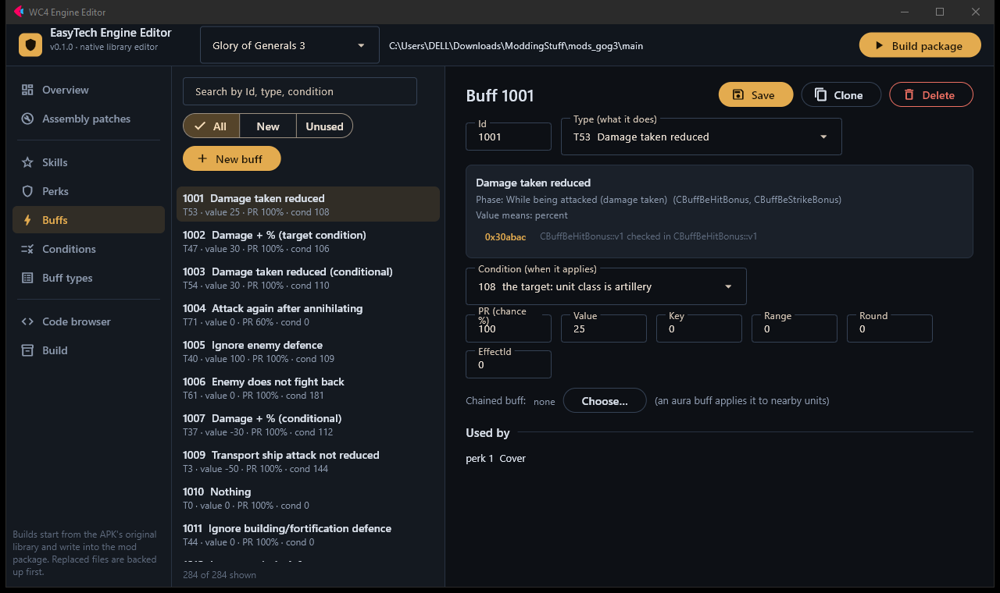
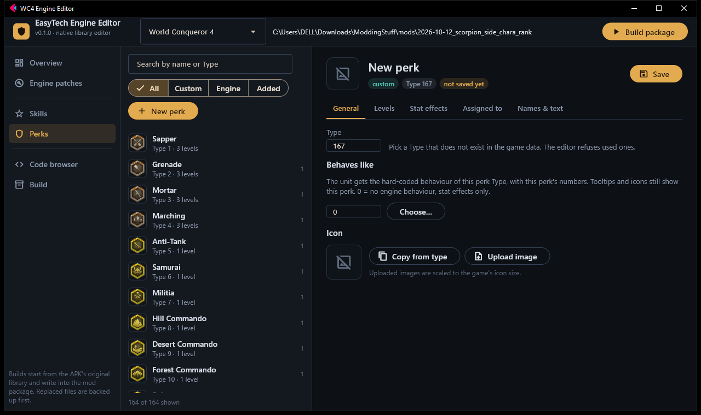
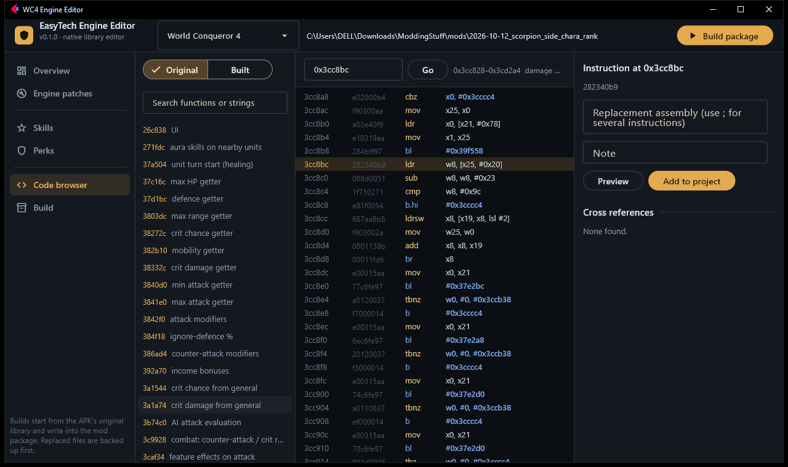

<div align="center">

# EasyTech Engine Editor

**A visual editor for the native engine of EasyTech strategy games: add and edit general skills, unit perks and engine behaviour without hex editing.**


-02569B?logo=flutter&logoColor=white)
[](LICENSE)




</div>

EasyTech games keep most of their rules inside one native library (`libworld-conqueror-4.so`, `libiron.so`), not in
the json files. The json tables only hold numbers; *what a skill does* is code. This editor reads that code, shows
where each skill, perk and effect is implemented, lets you add new ones, and writes the result into a mod package.

> **By [ReactionaryGod](https://github.com/ReactionaryGod).** Companion to the
> [EasyTech BTL Editor](https://github.com/ReactionaryGod/easytech-btl-editor) (battle maps).
> Pick the game in the top bar; both live in the same window.

## What it does

### World Conqueror 4 (1.30.0)
WC4 hard-codes each general skill and unit perk in the damage code (a switch case per Type). The editor therefore
extends the engine itself:

- **New skill and perk Types.** The engine's tables stopped at skill Type 191 and perk Type 166; anything higher
  overwrote other memory. A code cave (+64 KiB, new `.bss` tables) lifts the limit to Type 511.
- **"Behaves like".** A custom skill can also trigger the hard-coded effect of existing skills (it keeps its own
  name, icon, levels and numbers). A custom perk can run an existing perk's behaviour.
- **Stat effects** for any skill or perk: crit chance, crit damage, defence, mobility, attack %, max HP %, range,
  limited to unit classes.
- **Engine usage list:** every place the engine checks a given Type, one click from the code browser.
- Existing known patches (challenge-conquest caps, Mysterious Forces picker, General Bank seats, data-driven
  elite-skin effects) as switches.

### Glory of Generals 3
GoG3 is data-driven: a skill or perk is a list of **buffs** (condition, chance, effect Type, value, range, chained
buff). Conditions are defined in `config/def_buff.xml`; only each effect *Type* is code. So most new content needs no
code:

- **Skills, perks, buffs, conditions:** create, edit, clone, delete; assign to generals and units; names and texts in
  all 5 languages; icons (new ones go into their own atlas, registered in `image_resource.xml`).
- **Conditions:** build new ones with AND / OR / NOT over the 73 shipped conditions.
- **Buff types:** all 67 Types the engine implements (including 15 that no game data uses yet), what each does, and
  the code address of each, decoded from `libiron.so`.

### Both
- **Code browser:** functions, strings, disassembly, cross references, "original" vs "built" library, and an
  assemble-and-patch panel (keystone) that records patches in the project.
- **Safe builds:** always start from the original library, verify every patch site against the expected
  instructions, back up replaced files, append to `CHANGES.txt`.

<table><tr>
<td></td>
<td></td>
</tr></table>

## Run it

```bash
python -m venv .venv && .venv\Scripts\pip install -r requirements.txt
.venv\Scripts\python app.py            # or run.bat
```

The app lists the projects it knows in the top bar. On first start it looks for:

- a **WC4 mod package** under `..\mods\<name>\` (a folder with `assets\`, `lib\`, stringtables);
- a **GoG3** folder named by the `GOG3_DIR` environment variable (the unpacked APK: `assets\`, `lib\`).

Or open any package directly: `python app.py path\to\package`. A package keeps its settings in
`engine_project.json`:

```json
{ "game": "wc4",
  "paths": { "base_so": "...\\lib\\arm64-v8a\\libworld-conqueror-4.so",
             "assets": "...\\assets", "backups": "...\\backups" } }
```

`base_so` must be the **original** library from the APK; the editor writes its output into the package, never over the
original.

## How it is built

| Part | What |
|---|---|
| `wc4engine/elf.py`, `arm64.py` | ELF64 editor (segment growth), capstone + keystone wrappers |
| `wc4engine/framework.py` | the WC4 engine extension: ~2 KB of hand-written AArch64, 39 hook sites |
| `wc4engine/catalog.py`, `gog3/catalog.py` | where each skill / perk / buff Type is implemented |
| `wc4engine/rtti.py` | C++ RTTI: class names to vtables to virtual functions |
| `wc4engine/gog3/` | GoG3 data model, buff conditions, buff types |
| `wc4engine/gamedata.py`, `atlas.py` | format-preserving json / stringtable / atlas I/O |
| `wc4engine/ui/` | the Flet screens |

Details: [docs/wc4-engine-extension.md](docs/wc4-engine-extension.md), [docs/gog3-engine.md](docs/gog3-engine.md).

## Tests

They need the (unpacked) game files, which are not in this repository. Set `WC4_BASE_SO` / `WC4_GAME_DIR` and
`GOG3_DIR`, then:

```bash
python tests/test_framework.py              # emulates the new WC4 routines (Unicorn), incl. the engine's own max-HP routine
python tests/test_build.py <scratch dir>    # WC4 end-to-end build into a scratch package
python tests/test_gog3.py  <scratch dir>    # GoG3 data model; deleting everything restores the original bytes
```

**Status:** the engine extension is verified by emulation and by byte-level checks, **not yet by playing the game on
a device**. Treat WC4 builds as experimental until you have tested them in game.

## Adding another EasyTech game

The games share one engine design; only the library name and the data tables differ. A new game needs: a `Game`
entry in `projects.py`, a project class like `gog3/project.py` (paths, patches, build), a data store like
`gog3/store.py`, and a catalog of where its skills/buffs are implemented (`rtti.py` + switch decoding in
`catalog.py` do most of that work).

## Legal

An independent modding tool. It contains no game code or assets; you supply your own copy of the game. Not
affiliated with EasyTech.
